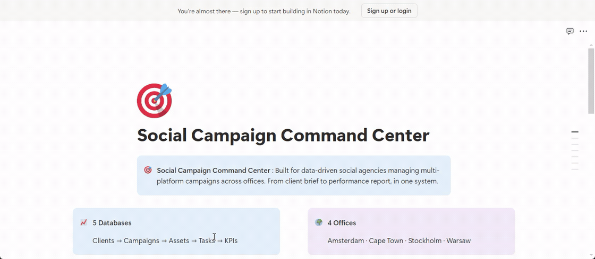
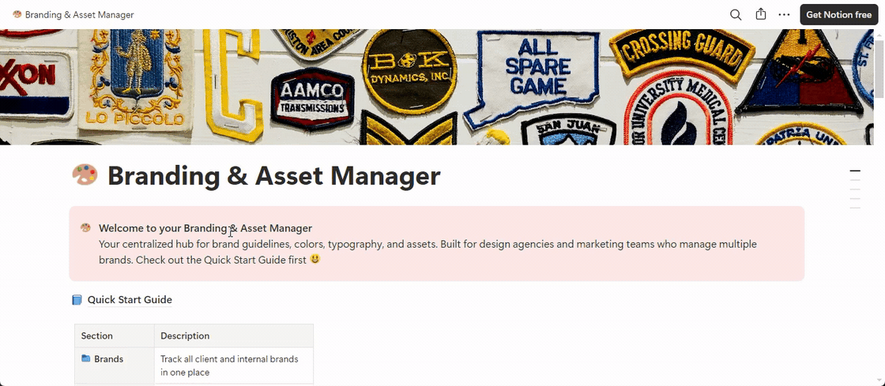
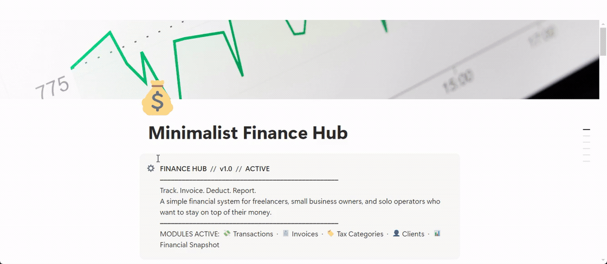

# Notion Workflow Templates

Three reusable Notion workspaces for campaign operations, brand management and freelance finances.

## Social Campaign Command Center

[Open the template](https://app.notion.com/p/Social-Campaign-Command-Center-53a56415d9714fc1b2f4a9febdcacec2)

Connects clients, campaigns, assets, tasks and KPIs in a social campaign workspace. The template describes automations for status changes, deadlines and approvals.

## Branding & Asset Manager

[Open the template](https://flat-rhythm-67d.notion.site/Branding-Asset-Manager-eea7954c3d744d55a6d92d5b2c81e023)

Organises brand guidelines, colour palettes, typography and creative assets for teams managing multiple brands.

## Minimalist Finance Hub

[Open the template](https://flat-rhythm-67d.notion.site/Minimalist-Finance-Hub-30dd929415008057875def5562962557)

Brings transactions, invoices, tax categories and clients together with a financial snapshot and reporting views for freelancers and small businesses.
